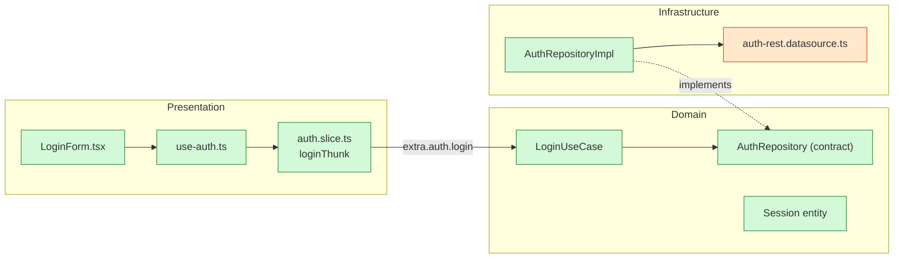

# Didactic diagrams

Two kinds of diagrams, both Mermaid (render in VS Code, GitHub, and the generated HTML page):

1. **Planned diagrams** — written by YOU (the orchestrator) into the plan during phase 4, before any code
   exists. They show the developer what will be built and where each piece lives.
2. **Generated diagrams** — produced from the real code by `scripts/diagram.mjs` after implementation
   (phase 7), in audit mode, or on demand (`/clean-feature diagram [feature]`).

## Generated diagrams (`npm run diagram:clean -- --feature <name>`)

`node .claude/skills/clean-feature/scripts/diagram.mjs [--feature <name>] [--out temp/clean-diagrams] [--format both|md|html]`

Writes `temp/clean-diagrams/<feature>.md` and `<feature>.html` (open the HTML in a browser; it loads Mermaid
11.4.1 from jsDelivr). Without `--feature`, it also adds an **architecture overview** of all features.

| Diagram | What it teaches |
|---|---|
| **Onion view** | The four rings (frameworks & drivers → interface adapters → application → entities) with the feature's real files in each. Shows that the domain is at the center and knows nothing about the outer rings. |
| **Dependency map** | Every file colored by layer and every import as an arrow. Solid = value import, dotted = `import type`. **Red = violates the dependency rule** (same model as `lint:clean`), listed under the diagram. |
| **Request flow** (one per thunk) | Traced from the code: user → component → facade hook → thunk → `extra.<feature>.<useCase>` → use case (validation note) → repository contract → implementation bound in `di/` → datasource → backend, then back: DTO → entity (`toDomain`) → view model → reducer → selectors → re-render. Includes the failure path (`toDomainError` → `rejectWithValue`). Participants are grouped in Presentation / Domain / Infrastructure boxes. |
| **Architecture overview** | Features × layers with file counts and cross-layer/cross-feature edges (red when forbidden). |

Optional PNG/SVG export (for slides or the README):
`npx -p @mermaid-js/mermaid-cli@11.4.2 mmdc -i temp/clean-diagrams/<feature>.md -o temp/clean-diagrams/<feature>.md -e png`
(on Windows without Chromium, pass `-p pp.json` with `{"executablePath": "<path to msedge.exe>"}`).

### Explaining them to the developer

When you present generated diagrams, walk through ONE request flow step by step (use the autonumber
numbers), and for each step name the layer and why it lives there (from `layers.md`). Then point at any red
arrow in the dependency map and explain which rule it breaks and the fix (from `audit-rules.md`).

## Planned diagrams (in the plan, phase 4)

Add a `## Diagrams` section to the plan with:

### 1. Planned layer map — color by reuse tag

Use `:::new`, `:::extend`, `:::reuse` matching the plan's Reuse table, so the developer sees at a glance what
is created vs. reused.

### 2. Planned request flow — one sequence diagram per user action

Same shape as the generated request flow (boxes Presentation / Domain / Infrastructure, `autonumber`,
`alt success / else failure`). For orchestrating use cases, show each repository call in the order the use case
decides it, e.g. `SignUpUseCase → AuthRepository.signUp()` then `ProfileRepository.create(userId)`, and what
happens if the second step fails.

Keep planned diagrams small (≤ 15 nodes / ≤ 25 messages). They are teaching aids, not full specs.
